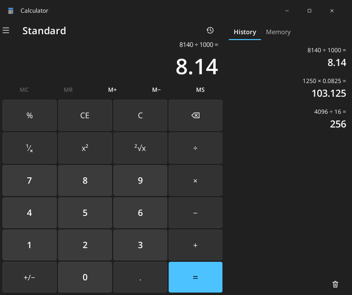
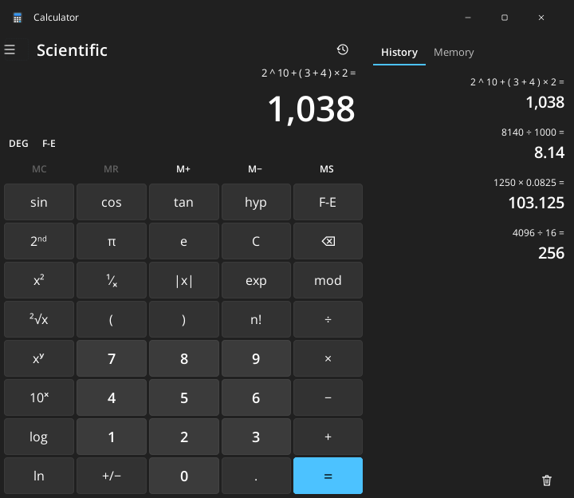
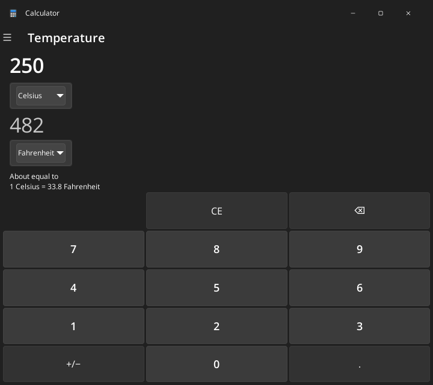

# pi-calculator

A Windows 11 Calculator style Calculator app for the Raspberry Pi (built for the Pi 5, works on other Pis running Raspberry Pi OS). Native GTK app with the Windows 11 dark look, made to match [pi-explorer](https://github.com/wvfouram/pi-explorer) and [pi-taskmgr](https://github.com/wvfouram/pi-taskmgr).



## Features

- **Standard** mode that works exactly like Windows (left to right, so 12 + 7 x 3 = 57), with %, 1/x, x squared and square root
- **Scientific** mode with brackets and proper order of operations, sin/cos/tan (and inverse, hyperbolic), DEG/RAD/GRAD, log, ln, powers, roots, n!, pi, e, mod and F-E notation
- **Programmer** mode: live HEX, DEC, OCT and BIN, AND, OR, XOR, NOT, NAND, shifts, 64-bit math
- **Date calculation**: the difference between two dates in years, months, days and total days
- **Converters**: length, weight, volume, temperature, area, speed, time, energy (including mAh at 3.7 V for LiPo packs), power, data, pressure and angle
- **History and Memory** panel that appears when the window is wide (click an entry to reuse it); MC, MR, M+, M-, MS
- Full keyboard support, Ctrl+C / Ctrl+V to copy or paste numbers





## Install

In a terminal on the Pi (as your normal user, not with sudo):

```
git clone https://github.com/wvfouram/pi-calculator.git && bash pi-calculator/install.sh
```

Then open **Calculator** from the menu, or run `pi-calculator`.

To update later:

```
cd ~/pi-calculator && git pull && bash install.sh
```

## Keyboard shortcuts

| Keys | Action |
|---|---|
| 0-9 . + - * / | Type numbers and operators |
| Enter or = | Equals |
| Esc / Delete / Backspace | Clear / Clear entry / Backspace |
| F9 | Change sign |
| Alt+1 / 2 / 3 / 4 | Standard / Scientific / Programmer / Date |
| Ctrl+H | History |
| Ctrl+M / R / P / Q / L | Memory store / recall / add / subtract / clear |

## Uninstall

```
bash pi-calculator/uninstall.sh
```

## License

MIT
